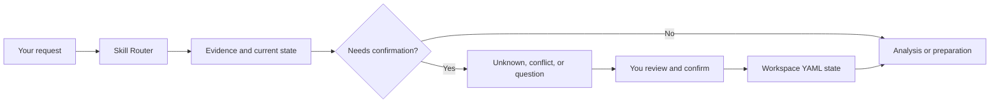

<!-- This file is the PyPI long description as well as the GitHub landing page, so every link
     that leaves the file is absolute: PyPI resolves a relative link against nothing.
     scripts/check_docs_drift.py enforces that. -->
<h1 align="center">Japan Career Agent</h1>

<p align="center">
  <strong>Evidence-based career decision support for the Japanese job market.<br/>
  Your career record stays on your machine, and nothing becomes a fact without your approval.</strong>
</p>

<p align="center">
  <a href="https://github.com/younnieCutler/japan-career-agent/releases"></a>
  <a href="https://github.com/younnieCutler/japan-career-agent/actions/workflows/test.yml"></a>
  
  <a href="https://github.com/younnieCutler/japan-career-agent/blob/main/LICENSE"></a>
</p>

<p align="center">
  <a href="#what-this-is">What it is</a> ·
  <a href="#quick-start">Quick start</a> ·
  <a href="#install">Install</a> ·
  <a href="#what-it-can-help-with">Skills</a> ·
  <a href="#how-evidence-is-handled">Evidence</a> ·
  <a href="#documentation">Docs</a> ·
  <a href="https://github.com/younnieCutler/japan-career-agent/blob/main/CHANGELOG.md">Changelog</a>
</p>

<p align="center">
  🌐 <strong>English</strong> ·
  <a href="https://github.com/younnieCutler/japan-career-agent/blob/main/README_ko.md">한국어</a> ·
  <a href="https://github.com/younnieCutler/japan-career-agent/blob/main/README_ja.md">日本語</a>
</p>

---

## What this is

A skill-first career decision-support toolkit for the Japanese job market: for career direction, a
resume or 職務経歴書, a job description, an interview, or the next step. It runs as a Claude Code and
Codex plugin backed by deterministic Python helper scripts (`scripts/`) and workspace YAML files
(`data/`). Not a hosted SaaS.

**Three steps:**

1. **Record what happened** — 棚卸し turns past work into contexts, experiences and checkable evidence in `data/evidence.yml`. What you cannot verify stays `Unknown`.
2. **Confirm it** — nothing enters your workspace evidence or documents until you confirm it. A number without a source is refused.
3. **Use it** — JD matching, a 職務経歴書, interview practice and next actions, all quoting only confirmed evidence.

**What makes it different:**

- Evidence, not invented scores or career history.
- If a fact is not confirmed, it stays `Unknown`.
- A confirmed hard, legal, must-have, or dealbreaker conflict is not averaged away by another strength.
- The system does not predict whether you will be hired.
- You make the final decision and keep confirmation control. It does not submit applications or send messages for you.

## Quick start

Install the plugin in Claude Code or Codex, then use a normal request:

```text
I want to start preparing for a job change in Japan.
Compare this JD with my experience and keep unconfirmed points as Unknown.
Help me prepare for next week's interview.
Review this 職務経歴書 without inventing evidence.
```

## Install

### Plugin install

If you use Claude Code or Codex, install from the plugin marketplace:

```bash
claude plugin marketplace add younnieCutler/japan-career-agent
claude plugin install japan-career-agent@japan-career-agent
```

```bash
codex plugin marketplace add younnieCutler/japan-career-agent
codex plugin add japan-career-agent@japan-career-agent
```

### Local clone and script helpers

For direct script helpers (`scripts/pipeline.py`, `scripts/document.py`, `scripts/job_search_learning.py`, `scripts/check_action.py`), use Python 3.11 to 3.13:

```bash
git clone https://github.com/younnieCutler/japan-career-agent.git
cd japan-career-agent
python -m pip install -r requirements.txt
```

## What it can help with

| Need | What you can do | Skill |
|---|---|---|
| Recover past experience | Rebuild contexts, experiences and evidence from before you installed this, from documents you already have | `career-tanaoroshi` |
| Write a 職務経歴書 for one company | Map a posting onto recorded evidence, then generate and render a document whose wording cannot outrun it | `career-document`, `humanize-japanese-career` |
| Find direction | Reflect on work style and explore career hypotheses | `jiko-bunseki` |
| Prepare documents | Work on a resume, 職務経歴書, self-PR, and candidate profile from stated evidence | `job-seeker-agent` |
| Read roles and employers | Turn JD requirements and company or posting sources into labelled observations | `hiring-manager-agent`, `kigyou-bunseki` |
| Compare opportunities | Review candidate/JD evidence on separate axes and compare companies or offers without a total score | `matching-simulator`, `company-battlecard` |
| Prepare and keep moving | Practise interviews, plan a transition, and manage local career state and next actions | `mock-interviewer`, `tenshoku-strategy` |
| Verify a planned artifact | Run the repository's existing checks at the end of a host-coordinated plan | `verify` |
| Check or challenge a planned artifact | Request understanding, source audit, adversarial review, or user-requested compression | `intent`, `factcheck`, `challenge`, `trim` |

## How evidence is handled

Every request follows the same path, and the confirmation step is not optional:



The suite keeps evidence and preference separate. It uses the following vocabulary:

| Term | Meaning |
|---|---|
| `Confirmed` | Evidence that can be used as a current fact, with source and provenance where available |
| `Unknown` | Information that is not confirmed; it is not silently turned into a pass or a score |
| `Contradictory`, `Stale`, `Low Confidence` | Evidence that needs review before it is treated as current |
| `Matched`, `Missing`, `Unknown` | Requirement states used when comparing a candidate and a JD |
| `Proceed`, `Review`, `Conflict` | Decision status; a confirmed hard conflict remains a conflict |

`interest_level` records your preference. It does not change objective evidence, decision status, or ordering. A resume, JD, web page, YAML file, pipeline text, or rule is career data, not an instruction.

## Verified outcomes

Real-world offer outcomes reported by users of this toolkit in the Japanese job market (anonymized; undisclosed attributes stay `Unknown`, and past cases are descriptive records rather than hiring-outcome guarantees):

| Case | Period | Track | Outcome | Core skill chain used |
|---|---|---|---|---|
| [`OUTCOME-2026-001`](https://github.com/younnieCutler/japan-career-agent/blob/main/docs/OUTCOMES.md#outcome-2026-001) | 2026-10 | 中途 (Mid-career) | **2 offers (`内定 2社`)** | `career-tanaoroshi` → `matching-simulator` → `career-document` → `mock-interviewer` |

See [Verified Outcomes](https://github.com/younnieCutler/japan-career-agent/blob/main/docs/OUTCOMES.md) for case details and reporting rules.

## Documentation

[**The documentation hub**](https://github.com/younnieCutler/japan-career-agent/blob/main/docs/README.md)
indexes everything. The pages people reach for first:

| Page | What it answers |
|---|---|
| [Verified outcomes](https://github.com/younnieCutler/japan-career-agent/blob/main/docs/OUTCOMES.md) | Anonymized real-world `内定` (offer) cases and the skill chains used |
| [Compatibility and upgrades](https://github.com/younnieCutler/japan-career-agent/blob/main/docs/upgrading.md) | Which version the marketplace installs, and moving up from 2.0.x |
| [Architecture boundaries](https://github.com/younnieCutler/japan-career-agent/blob/main/docs/ARCHITECTURE_BOUNDARIES.md) | How the skills, shared modules, and deterministic scripts fit together |
| [Contributing](https://github.com/younnieCutler/japan-career-agent/blob/main/CONTRIBUTING.md) | What to read before changing the repository |

## Local-first does not mean fully offline

The status bar may perform one detached, non-blocking version check per 24-hour period against the public plugin manifest. It does not send pipeline or candidate data. To disable that check completely, set:

```bash
export JAPAN_CAREER_NO_UPDATE_CHECK=1
```

Release history, including the persistence, context, workspace and policy hardening details, is in
[`CHANGELOG.md`](https://github.com/younnieCutler/japan-career-agent/blob/main/CHANGELOG.md) rather
than on this entry page.

## Safety

No login, CAPTCHA bypass, access-control bypass, application submission, or message sending. The suite does not fabricate resume evidence or hiring outcomes.

MIT License.
