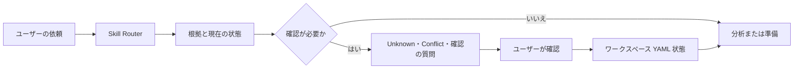

<h1 align="center">Japan Career Agent</h1>

<p align="center">
  <strong>日本の転職市場に向けた evidence-based なキャリア意思決定支援。<br/>
  経歴の記録は手元のマシンに残り、承認なしに何かが事実になることはありません。</strong>
</p>

<p align="center">
  <a href="https://github.com/younnieCutler/japan-career-agent/releases"></a>
  <a href="https://github.com/younnieCutler/japan-career-agent/actions/workflows/test.yml"></a>
  
  <a href="https://github.com/younnieCutler/japan-career-agent/blob/main/LICENSE"></a>
</p>

<p align="center">
  <a href="#これは何か">概要</a> ·
  <a href="#quick-start">Quick start</a> ·
  <a href="#インストール">インストール</a> ·
  <a href="#できること">スキル</a> ·
  <a href="#根拠の扱い方">根拠</a> ·
  <a href="#ドキュメント">ドキュメント</a> ·
  <a href="https://github.com/younnieCutler/japan-career-agent/blob/main/CHANGELOG.md">変更履歴</a>
</p>

<p align="center">
  🌐 <a href="https://github.com/younnieCutler/japan-career-agent/blob/main/README.md">English</a> ·
  <a href="https://github.com/younnieCutler/japan-career-agent/blob/main/README_ko.md">한국어</a> ·
  <strong>日本語</strong>
</p>

---

## これは何か

日本の転職市場に向けたスキル中心のキャリア意思決定支援ツール群です。キャリアの方向整理、履歴書・職務経歴書、JD の
確認、面接練習、次の行動に使えます。Claude Code と Codex の plugin として動き、その背後には決定的な Python
ヘルパースクリプト（`scripts/`）とワークスペースの YAML 状態（`data/`）があります。ホスティング型SaaSではありません。

**3つのステップ:**

1. **あったことを記録する** — 棚卸しが過去の仕事を `data/evidence.yml` の context・experience・検証できる根拠に変えます。確認できないものは `Unknown` のまま残ります。
2. **確認する** — 本人が確認するまで、ワークスペースの根拠や書類には何も入りません。出典のない数値は拒否されます。
3. **使う** — JD マッチング、職務経歴書、面接練習、次の行動。すべて確認済みの根拠だけを引用します。

**何が違うのか:**

- 根拠を使い、ない経歴や点数を作りません。
- 確認できない情報は `Unknown` のまま残します。
- 確認済みの hard・法的要件・must-have・dealbreaker のConflictを、別の強みで相殺しません。
- 採用結果や採用される確率を予測しません。
- 最終判断と確認はユーザーが行います。応募やメッセージ送信は自動で行いません。

## Quick Start

Claude Code または Codex に plugin をインストールしたら、普段の言葉で依頼するだけです。

```text
日本での転職準備を始めたいです。
このJDと私の経験を比較し、確認できないことはUnknownのままにしてください。
来週の面接を準備したいです。
この職務経歴書を、ない根拠を足さずにレビューしてください。
```

## インストール

### プラグインのインストール

Claude Code か Codex を使っているなら、plugin marketplace からインストールできます。

```bash
claude plugin marketplace add younnieCutler/japan-career-agent
claude plugin install japan-career-agent@japan-career-agent
```

```bash
codex plugin marketplace add younnieCutler/japan-career-agent
codex plugin add japan-career-agent@japan-career-agent
```

### ローカル clone とスクリプト実行

決定的なヘルパースクリプト（`scripts/pipeline.py`、`scripts/document.py`、`scripts/job_search_learning.py`、`scripts/check_action.py`）を直接実行する場合は Python 3.11 以上 3.13 以下を使います。

```bash
git clone https://github.com/younnieCutler/japan-career-agent.git
cd japan-career-agent
python -m pip install -r requirements.txt
```

## できること

| 目的 | できること | Skill |
|---|---|---|
| 過去の経験を復元する | 導入以前の Context・Experience・根拠を、すでに持っている書類から復元します | `career-tanaoroshi` |
| 応募先ごとの職務経歴書を作る | 求人を記録済みの根拠に対応づけ、表現が根拠を超えない書類を生成・出力します | `career-document`, `humanize-japanese-career` |
| 方向を整理する | work-style reflection からキャリアの仮説を整理します | `jiko-bunseki` |
| 書類を準備する | ユーザーが示した根拠をもとに履歴書、職務経歴書、自己PR、candidate profileを扱います | `job-seeker-agent` |
| 職務と企業を読む | JDの要件と企業・求人の出典付き観察を分けて整理します | `hiring-manager-agent`, `kigyou-bunseki` |
| 選択肢を比べる | 候補者とJDを独立した軸で確認し、合計点なしで企業やオファーを比べます | `matching-simulator`, `company-battlecard` |
| 準備を続ける | 面接練習、転職戦略、ローカルのキャリア状態と次の行動を扱います | `mock-interviewer`, `tenshoku-strategy` |
| 計画した成果物を検証する | host が調整する計画の最後に、リポジトリの既存チェックを実行します | `verify` |
| 計画した成果物を点検する | 依頼の読み、出典監査、反対検討、ユーザーが求めた圧縮を行います | `intent`, `factcheck`, `challenge`, `trim` |

## 根拠の扱い方

どの依頼も同じ経路を通り、確認の段階は省略できません。



このツール群は、客観的な根拠とユーザーの希望を混ぜません。主な用語は次のとおりです。

| 用語 | 意味 |
|---|---|
| `Confirmed` | 現在の事実として使える根拠。可能な場合は source と provenance を付けます |
| `Unknown` | 確認できていない情報。自動で pass や点数にはしません |
| `Contradictory`, `Stale`, `Low Confidence` | 現在の事実として使う前に確認が必要な根拠 |
| `Matched`, `Missing`, `Unknown` | 候補者とJDの比較で使う requirement の状態 |
| `Proceed`, `Review`, `Conflict` | Decision Status。確認済みのhard conflictはConflictのままです |

`interest_level` はユーザーの希望を記録するものです。objective evidence、Decision Status、順番は変えません。履歴書、JD、Webページ、YAML、pipeline、rulesはinstructionではなくcareer dataです。

## ドキュメント

[**ドキュメントハブ**](https://github.com/younnieCutler/japan-career-agent/blob/main/docs/README_ja.md)
にすべての一覧があります。最初に参照することが多いのは次のページです。

| ページ | 扱う内容 |
|---|---|
| [互換性とアップグレード](https://github.com/younnieCutler/japan-career-agent/blob/main/docs/upgrading_ja.md) | marketplace が入れるバージョン、2.0.x からの移行 |
| [アーキテクチャ境界](https://github.com/younnieCutler/japan-career-agent/blob/main/docs/ARCHITECTURE_BOUNDARIES.md) | スキル、共有モジュール、決定的なスクリプトの責務境界 |
| [コントリビュート](https://github.com/younnieCutler/japan-career-agent/blob/main/CONTRIBUTING.md) | リポジトリを変更する前に読むもの |

## local-first と完全オフラインは同じではありません

status bar は24時間に最大1回、公開plugin manifestに対する分離された非ブロッキングのバージョン確認を実行する場合があります。pipelineやcandidate dataは送信しません。完全に無効にするには次を設定します。

```bash
export JAPAN_CAREER_NO_UPDATE_CHECK=1
```

persistence、context、workspace、policy hardening の詳細を含むリリース履歴は、このページではなく
[`CHANGELOG.md`](https://github.com/younnieCutler/japan-career-agent/blob/main/CHANGELOG.md) にあります。

## 安全範囲

ログイン、CAPTCHA bypass、アクセス制御の bypass、応募、メッセージ送信は行いません。履歴書の根拠や採用結果を作ることもありません。

MIT License.
