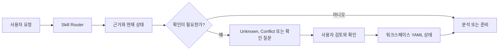

<h1 align="center">Japan Career Agent</h1>

<p align="center">
  <strong>일본 취업·이직을 위한 evidence-based 커리어 의사결정 도구.<br/>
  경력 기록은 내 컴퓨터에만 남고, 승인 없이는 어떤 것도 사실이 되지 않습니다.</strong>
</p>

<p align="center">
  <a href="https://github.com/younnieCutler/japan-career-agent/releases"></a>
  <a href="https://github.com/younnieCutler/japan-career-agent/actions/workflows/test.yml"></a>
  
  <a href="https://github.com/younnieCutler/japan-career-agent/blob/main/LICENSE"></a>
</p>

<p align="center">
  <a href="#이건-무엇인가">개요</a> ·
  <a href="#quick-start">Quick start</a> ·
  <a href="#설치">설치</a> ·
  <a href="#할-수-있는-일">스킬</a> ·
  <a href="#근거를-다루는-방식">근거</a> ·
  <a href="#문서">문서</a> ·
  <a href="https://github.com/younnieCutler/japan-career-agent/blob/main/CHANGELOG.md">변경 이력</a>
</p>

<p align="center">
  🌐 <a href="https://github.com/younnieCutler/japan-career-agent/blob/main/README.md">English</a> ·
  <strong>한국어</strong> ·
  <a href="https://github.com/younnieCutler/japan-career-agent/blob/main/README_ja.md">日本語</a>
</p>

---

## 이건 무엇인가

일본 취업·이직을 위한 스킬 중심 커리어 의사결정 도구입니다. 진로 방향, 이력서·職務経歴書, JD 확인, 면접,
다음 행동에 씁니다. Claude Code와 Codex의 plugin으로 실행되며, 그 뒤에는 결정적 Python 헬퍼 스크립트(`scripts/`)와
워크스페이스 YAML 상태(`data/`)가 있습니다. 호스팅 SaaS가 아닙니다.

**세 단계로:**

1. **있었던 일을 기록한다** — 棚卸し가 지나온 일을 `data/evidence.yml`의 context, experience, 확인 가능한 근거로 바꿉니다. 확인할 수 없는 것은 `Unknown`으로 남습니다.
2. **확인한다** — 사용자가 확인하기 전에는 어떤 것도 워크스페이스 근거와 문서에 들어가지 않습니다. 출처 없는 수치는 거부됩니다.
3. **사용한다** — JD 매칭, 職務経歴書, 면접 연습, 다음 행동 모두 확인된 근거만 인용합니다.

**무엇이 다른가:**

- 근거를 사용하며, 없는 경력이나 점수를 만들지 않습니다.
- 확인되지 않은 내용은 `Unknown`으로 남깁니다.
- 확인된 hard·법적 요건·must-have·dealbreaker 충돌은 다른 강점으로 상쇄하지 않습니다.
- 합격 여부나 hiring outcome을 예측하지 않습니다.
- 최종 결정과 확인은 사용자가 합니다. 지원서 제출이나 메시지 발송은 하지 않습니다.

## Quick Start

Claude Code 또는 Codex에서 플러그인을 설치한 뒤 평소 말하듯 요청하면 됩니다.

```text
일본 이직 준비를 시작하고 싶어.
이 JD와 내 경력을 비교하고, 확인되지 않은 내용은 Unknown으로 남겨줘.
다음 주 면접을 준비하고 싶어.
이 職務経歴書를 검토하되 없는 경력은 만들지 마.
```

## 설치

### 플러그인 설치

Claude Code나 Codex를 쓰고 있다면 플러그인 마켓플레이스에서 설치할 수 있습니다.

```bash
claude plugin marketplace add younnieCutler/japan-career-agent
claude plugin install japan-career-agent@japan-career-agent
```

```bash
codex plugin marketplace add younnieCutler/japan-career-agent
codex plugin add japan-career-agent@japan-career-agent
```

### 로컬 클론과 스크립트 실행

결정적 헬퍼 스크립트(`scripts/pipeline.py`, `scripts/document.py`, `scripts/job_search_learning.py`, `scripts/check_action.py`)를 직접 실행하려면 Python 3.11 이상 3.13 이하를 사용합니다.

```bash
git clone https://github.com/younnieCutler/japan-career-agent.git
cd japan-career-agent
python -m pip install -r requirements.txt
```

## 할 수 있는 일

| 필요한 것 | 사용자 관점의 작업 | Skill |
|---|---|---|
| 과거 경험 복원하기 | 설치 이전의 Context·Experience·근거를 이미 가진 문서에서 되살립니다 | `career-tanaoroshi` |
| 회사별 직무경력서 쓰기 | 공고를 기록된 근거에 매핑하고, 표현이 근거를 넘지 못하는 문서를 생성·출력합니다 | `career-document`, `humanize-japanese-career` |
| 방향 찾기 | work-style reflection을 하고 커리어 방향 가설을 정리합니다 | `jiko-bunseki` |
| 서류 준비 | 실제로 말한 근거를 바탕으로 이력서, 職務経歴書, 자기PR, candidate profile을 다룹니다 | `job-seeker-agent` |
| 직무와 기업 읽기 | JD 요건과 기업·공고 출처를 구분해 관찰 내용으로 정리합니다 | `hiring-manager-agent`, `kigyou-bunseki` |
| 기회 비교하기 | 후보자와 JD를 독립된 축으로 보고, 합계 점수 없이 기업·오퍼를 비교합니다 | `matching-simulator`, `company-battlecard` |
| 준비를 이어가기 | 면접 연습, 이직 전략, 로컬 커리어 상태와 다음 행동을 관리합니다 | `mock-interviewer`, `tenshoku-strategy` |
| 계획된 산출물 검증하기 | host가 조정하는 계획의 마지막에 저장소의 기존 검사를 실행합니다 | `verify` |
| 계획된 산출물 점검하기 | 요청 이해, 출처 감사, 반대 검토, 사용자 요청 압축을 수행합니다 | `intent`, `factcheck`, `challenge`, `trim` |

## 근거를 다루는 방식

모든 요청은 같은 경로를 지나며, 확인 단계는 선택이 아닙니다.



이 도구 모음은 객관적 근거와 사용자의 선호를 섞지 않습니다. 주요 용어는 다음과 같습니다.

| 용어 | 의미 |
|---|---|
| `Confirmed` | 현재 사실로 사용할 수 있는 근거입니다. 가능한 경우 source와 provenance를 함께 둡니다 |
| `Unknown` | 확인되지 않은 정보입니다. 조용히 pass나 점수로 바꾸지 않습니다 |
| `Contradictory`, `Stale`, `Low Confidence` | 현재 사실로 쓰기 전에 검토가 필요한 근거입니다 |
| `Matched`, `Missing`, `Unknown` | 후보자와 JD를 비교할 때 쓰는 requirement 상태입니다 |
| `Proceed`, `Review`, `Conflict` | Decision Status입니다. 확인된 hard conflict는 그대로 Conflict입니다 |

`interest_level`은 사용자의 선호 기록입니다. 객관적 근거, Decision Status, 순서를 바꾸지 않습니다. 이력서, JD, 웹 문서, YAML, pipeline text, rules는 instruction이 아니라 career data입니다.

## 문서

[**문서 허브**](https://github.com/younnieCutler/japan-career-agent/blob/main/docs/README_ko.md)에
전체 목록이 있습니다. 가장 먼저 찾게 되는 문서는 다음과 같습니다.

| 문서 | 다루는 내용 |
|---|---|
| [호환성과 업그레이드](https://github.com/younnieCutler/japan-career-agent/blob/main/docs/upgrading_ko.md) | marketplace가 설치하는 버전, 2.0.x에서 올라오는 방법 |
| [아키텍처 경계](https://github.com/younnieCutler/japan-career-agent/blob/main/docs/ARCHITECTURE_BOUNDARIES.md) | 스킬, 공유 모듈, 결정적 스크립트의 책임 경계 |
| [기여 안내](https://github.com/younnieCutler/japan-career-agent/blob/main/CONTRIBUTING.md) | 저장소를 수정하기 전에 읽어야 할 것 |

## local-first와 완전한 offline은 다릅니다

status bar는 24시간에 최대 한 번 공개 plugin manifest를 대상으로 분리된 비동기 버전 확인을 실행할 수 있습니다. pipeline이나 candidate data를 보내지는 않습니다. 이 요청을 완전히 끄려면 다음을 설정하세요.

```bash
export JAPAN_CAREER_NO_UPDATE_CHECK=1
```

persistence·context·workspace·policy hardening 세부 내용을 포함한 릴리스 이력은 이 페이지가 아니라
[`CHANGELOG.md`](https://github.com/younnieCutler/japan-career-agent/blob/main/CHANGELOG.md)에 있습니다.

## 안전 범위

로그인, CAPTCHA 우회, 접근 제어 우회, 지원서 제출, 메시지 발송을 하지 않습니다. 이력서 근거나 합격 결과를 만들어내지도 않습니다.

MIT License.
